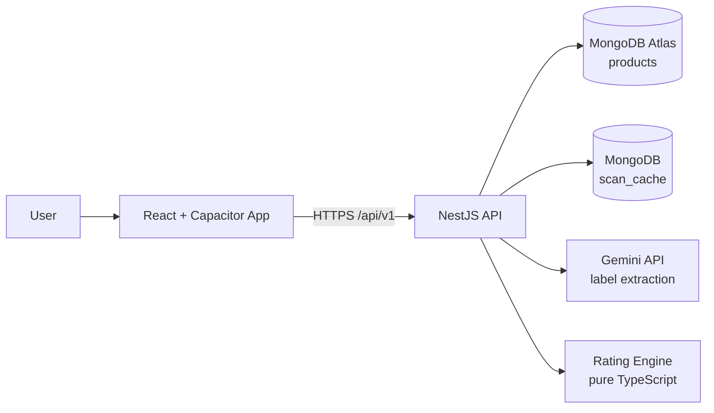
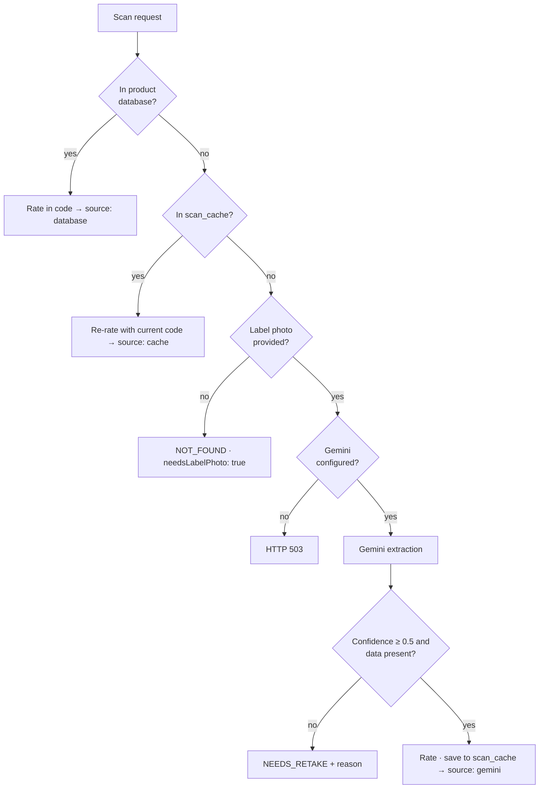

# CheckPoint!! — Product Health Intelligence Platform

> **Scan it. Know it.** Scan packaged food and feminine hygiene products, decode the ingredients, and get an explainable **A–E health grade** — built for Indian consumers.

Built for **HackCBS 9.0**.

---

## Problem Statement

Packaged food and feminine hygiene products are part of everyday life in India, yet the people buying them have very little practical way to judge what is inside.

- **Labels are hard to read and harder to judge.** Nutrition tables are in small print, per-serving values hide the real per-100 g picture, and ingredient lists are long and technical.
- **Important ingredients are hidden behind vague wording.** Palm oil often appears as "edible vegetable oil", and additives show up as E-numbers or INS codes that most shoppers cannot decode.
- **Sanitary products are even less transparent.** Fragrance, chlorine bleaching and plastic layers are rarely explained, and there is no simple way to compare pads and similar products on safety.
- **Pregnancy adds risk.** Ingredients such as alcohol, high-dose retinol or certain herbs matter much more during pregnancy, but are easy to miss.
- **Existing tools fall short for Indian shoppers.** Many rating apps are built on Western product databases, miss local brands and barcodes, and are not available in Hindi.
- **AI-only answers are hard to trust.** Asking a chatbot "is this healthy?" gives answers that can change from one run to the next and cannot be audited.

### Our Solution

CheckPoint!! turns a barcode scan or a label photo into a clear, explainable **A–E grade** in seconds. It reads labels with Gemini, but all scoring is done by **deterministic code**, so the same product always gets the same grade and every point can be traced to a reason. It flags palm oil, additives and pregnancy-sensitive ingredients, covers both food and sanitary products, and works in English and Hindi on an Android app.

## Overview

CheckPoint!! lets a user scan a barcode (or photograph a label) and instantly see:

- an **A–E grade** with the reasons behind it,
- **palm oil** detection and **additive (E/INS) codes** found in the ingredients,
- **pregnancy-related ingredient warnings**,
- a plain-language **AI explanation** of the product.

The grade is computed by **deterministic code, never by the AI**. Gemini is used only to *read* label photos (OCR + structured extraction); the rating engine then scores the extracted data, so results are reproducible and auditable.

## Features

- **Barcode scanner** with flashlight control and manual entry (8–14 digit barcodes).
- **Label photo scanner** — photograph the nutrition table and ingredients; Gemini extracts them into structured data, with a "retake photo" path when confidence is low.
- **Dual product categories** — Food & Nutrition, and Women's Sanitary Care (period products), each with its own rubric.
- **Explainable rating** — points breakdown, reasons list, method note, and data-quality flag (`complete` / `partial`).
- **Palm oil detection** — `yes` / `possible` / `no`, with a one-level grade downgrade when confirmed.
- **Additive detection** — finds E-numbers and INS codes (including bracketed groups like `Raising Agents [503(ii), 500(ii)]`).
- **Pregnancy warnings** — flags alcohol, caffeine/guarana, unpasteurised items, high-dose retinol, St. John's Wort and Dong Quai (warnings only, grades unchanged).
- **AI explainer screen** — "The Big Picture", why the grade was given, alternatives, and suggested questions.
- **Scan history, watchlist, explore, profile** screens with personalised allergen/additive alerts.
- **Bilingual UI** — English and Hindi.
- **Android app** via Capacitor, plus a **promotion site** with APK download and QR code.

## Architecture



### Scan decision tree

Every scan follows the same ordered logic (`backend/src/scan/scan.service.ts`):



**Design rule:** the API writes **only** to `scan_cache` during scans and never modifies the curated product collection.

## Tech Stack

| Layer | Technologies |
| --- | --- |
| **Backend** | NestJS 11, TypeScript, Mongoose (MongoDB Atlas), `@google/genai` (Gemini), `class-validator`, `@nestjs/throttler`, Jest |
| **Frontend** | React 19, TypeScript, Vite, Tailwind CSS 4, Zustand, TanStack Query, Axios, React Router 7, `html5-qrcode`, Lucide |
| **Mobile** | Capacitor 8 (Android), app ID `com.checkpoint.healthintelligence` |
| **Data / ML** | Python notebooks (pandas, NumPy, PyMongo) run on Google Colab |
| **Infra** | Render (backend), Docker, GitHub Actions (APK build) |

## Project Structure

```
.
├── backend/                  NestJS API
│   ├── src/
│   │   ├── health/           Health-check endpoint
│   │   ├── products/         Product CRUD-lite + lookup (controller, service, repository, DTOs)
│   │   ├── scan/             Barcode + label scan flow, scan_cache repository
│   │   ├── rating/           Rating engine (nutri-score, palm oil, additives, pregnancy flags)
│   │   ├── gemini/           Gemini client + structured extraction schema
│   │   ├── database/         Mongoose connection module
│   │   └── common/filters/   Mongo exception filter
│   ├── scripts/              Product data update scripts
│   ├── seed-famous-products.js
│   ├── test/                 E2E tests
│   └── Dockerfile
├── frontend/                 React + Vite + Capacitor app
│   ├── src/
│   │   ├── app/              Routes and layout
│   │   ├── features/         home, products, ai-explainer, women-hygiene,
│   │   │                     history, explore, watchlist, profile, ingredients
│   │   ├── components/       shared (scanner, search, nav) and ui primitives
│   │   ├── services/api/     API client, endpoints, scan/product/AI services
│   │   ├── store/            Zustand stores (user, scan, language, theme, product)
│   │   └── types/, utils/
│   ├── android/              Capacitor Android project
│   └── DESIGN.md             Design system ("Neo-Kinetic Consumer Tech")
├── models/                   Colab notebooks for dataset cleaning & loading
├── promotion/                Landing page + APK download portal
├── .github/workflows/        build-apk.yml
└── render.yaml               Render deployment blueprint (backend)
```

## How Rating Works

All grading lives in `backend/src/rating/` and is covered by unit tests.

### Food — simplified Nutri-Score (per 100 g)

Inputs: energy (kJ), sugars, saturated fat, sodium (mg), fibre, protein, fruit/veg %.

- Negative points **N** = energy + sugars + saturated fat + sodium points.
- If **N < 11** → `score = N − (fibre + protein + fruitVeg)`.
- If **N ≥ 11** and fruit/veg < 5 % → `score = N − (fibre + fruitVeg)` (protein excluded).

| Score | Grade |
| --- | --- |
| ≤ −1 | **A** |
| 0 – 2 | **B** |
| 3 – 10 | **C** |
| 11 – 18 | **D** |
| ≥ 19 | **E** |

**Palm oil downgrade:** confirmed palm oil lowers the grade by one level (E stays E).

> This is a simplified general-food version. The official scheme uses separate tables for beverages, fats and cheeses.

### Period hygiene products — transparent rubric

| Attribute | Points |
| --- | --- |
| Fragrance / perfume | −2 |
| Chlorine bleached | −2 |
| Synthetic plastic / polyethylene layer | −1 |
| Organic cotton | +2 |
| Conventional cotton | +1 |
| Biodegradable / compostable | +1 |
| Dermatologically tested | +1 |

Mapping: ≥ 3 → **A**, 2 → **B**, 1 → **C**, 0 → **D**, < 0 → **E**.

### Pregnancy flags

Ingredient patterns in `rating/data/pregnancy-flags.json` produce warnings (with a "consult your doctor" disclaimer) without changing the grade. The flag list should be reviewed by a medical professional before production use.

## Getting Started

### Prerequisites

- Node.js 20+ (22 recommended) and npm 10+
- A MongoDB database (e.g. MongoDB Atlas) containing the product collection
- A [Google AI Studio](https://aistudio.google.com/) API key for Gemini (needed for label-photo scanning)

### 1. Backend

```bash
cd backend
cp .env.example .env      # then fill in MONGODB_URI and GEMINI_API_KEY
npm install
npm run start:dev
```

The API listens on `http://localhost:3000/api/v1`. Verify it:

```bash
curl http://localhost:3000/api/v1/health
```

Production-style run:

```bash
npm run build
npm run start:prod
```

### 2. Frontend

```bash
cd frontend
cp .env.example .env      # set VITE_API_URL to your backend, e.g. http://localhost:3000/api/v1
npm install
npm run dev
```

### 3. Promotion site (optional)

```bash
cd promotion
npm install
npm run dev
```

### 4. Docker (backend)

```bash
cd backend
docker build -t checkpoint-backend .
docker run -p 8000:8000 --env-file .env checkpoint-backend
```

The container defaults to port `8000`.

## Environment Variables

### Backend (`backend/.env`)

| Variable | Description | Default / Example |
| --- | --- | --- |
| `NODE_ENV` | Runtime environment | `development` |
| `PORT` | HTTP port | `3000` |
| `API_PREFIX` | Global route prefix | `api/v1` |
| `CORS_ORIGIN` | `*` or comma-separated origins | `*` |
| `MONGODB_URI` | MongoDB connection string | — (required) |
| `MONGODB_COLLECTION` | Product collection name | `products` |
| `SCAN_CACHE_COLLECTION` | Cache collection for scanned products | `scan_cache` |
| `GEMINI_API_KEY` | Google AI Studio key | — (required for label scans) |
| `GEMINI_MODEL` | Gemini model name | `gemini-2.5-flash` |

### Frontend (`frontend/.env`)

| Variable | Description |
| --- | --- |
| `VITE_API_URL` | Base URL of the backend, including `/api/v1` |
| `VITE_APP_NAME` | App display name |
| `VITE_APP_VERSION` | App version string |

> Never commit real credentials. `.env` files are gitignored.

## API Reference

Base path: `/api/v1`

| Method | Path | Description |
| --- | --- | --- |
| `GET` | `/health` | API status and MongoDB connectivity |
| `GET` | `/products?page=1&limit=20` | Paginated product list |
| `GET` | `/products/barcode/:barcode` | Look up a product by barcode |
| `GET` | `/products/:productId` | Look up a product by ID |
| `POST` | `/products` | Create a product *(auth guard planned, currently open)* |
| `GET` | `/scan/:barcode` | Barcode scan: database → cache → `needsLabelPhoto` |
| `POST` | `/scan/label` | Label photo scan with Gemini extraction (rate limited: 10 requests / minute) |

### `POST /scan/label` body

```json
{
  "barcode": "8901719101068",
  "imageBase64": "<base64 image, max ~10 MB>",
  "mimeType": "image/jpeg",
  "categoryHint": "food"
}
```

- `barcode` — optional, 8–14 digits
- `mimeType` — `image/jpeg`, `image/png` or `image/webp`
- `categoryHint` — optional: `food`, `period` or `pregnancy`

### Possible scan outcomes

| Outcome | Meaning |
| --- | --- |
| Rated result (`source`: `database` / `cache` / `gemini`) | Grade, score, reasons, warnings, palm oil, additives, data quality |
| `NOT_FOUND` + `needsLabelPhoto: true` | Unknown barcode; ask the user for a label photo |
| `NEEDS_RETAKE` + `reason` | Gemini confidence too low or label unreadable |
| HTTP `503` | Photo sent but Gemini is not configured |

## Android App (APK)

The frontend is wrapped with Capacitor.

```bash
cd frontend
npm run cap:build          # builds web assets and syncs to android/
cd android
./gradlew assembleDebug    # APK at app/build/outputs/apk/debug/
```

Or open `frontend/android` in Android Studio and use **Build → Build APK(s)**. Copy the resulting APK into `promotion/downloads/` (or `promotion/public/downloads/`) to serve it from the promotion site.

## Data Pipeline

The `models/` folder holds Google Colab notebooks (`dataset.ipynb`, `sanitaryproducts.ipynb`) that prepare the product database:

1. Load a large product CSV in chunks and keep only the required columns.
2. Clean and coerce numeric fields; drop invalid or negative values.
3. **Normalise nutrition to per-100 g** from serving-based values (keeping the originals).
4. Detect **palm oil** (`yes` / `possible`) from ingredient text.
5. Generate a stable `productId` (SHA-256 hash of name, brand, category, sub-category).
6. Standardise the nutrition schema and load into MongoDB (`food_database.products`).

Helper scripts in `backend/` (`seed-famous-products.js`, `scripts/update-fmcg-products.js`) seed and update popular Indian FMCG products.

## Deployment & CI

- **Backend:** `render.yaml` defines a Render web service (Node, free plan, health check at `/api/v1/health`). `MONGODB_URI` and `GEMINI_API_KEY` must be set as secrets in the Render dashboard.
- **Android build:** `.github/workflows/build-apk.yml` runs on pushes and PRs to `main` (and manually): installs deps, builds with Vite, syncs Capacitor, runs `gradlew assembleDebug`, and uploads the APK as the `CheckPoint-Debug-APK` artifact (14-day retention). Set the `VITE_API_URL` secret or variable to point the build at your backend.
- **Promotion site:** static build, deployable to Vercel, Netlify, GitHub Pages or Firebase Hosting.

## Testing

```bash
cd backend
npm test            # unit tests (rating, scan, products, gemini, health)
npm run test:e2e    # end-to-end tests
npm run test:cov    # coverage
npm run lint
```

## Current Status & Roadmap

**Working today**

- Barcode lookup, label-photo extraction, caching and the full rating engine on the backend.
- Scan, analysis, history, explore, watchlist, profile and women's hygiene screens in the app.

**Known gaps**

- The frontend defines endpoints for auth, user preferences, ratings, feedback, evidence, regulations and AI chat/explain that the backend does not implement yet. Those screens currently fall back to **mock / simulated data**.
- `POST /products` is unauthenticated; a JWT guard is planned.
- Pregnancy flag list needs medical review.

**Roadmap ideas**

- [ ] User accounts and cloud-synced history/watchlist
- [ ] Backend AI explainer and Q&A endpoints (Gemini) replacing the simulated responses
- [ ] Evidence and regulation lookups (FSSAI, BIS IS 5405:2019, CDSCO)
- [ ] Beverage, fat and cheese tables for fuller Nutri-Score coverage
- [ ] More languages beyond English and Hindi
- [ ] iOS build

## Disclaimer

CheckPoint!! provides informational ratings based on label data and a simplified scoring method. It is **not medical or dietary advice**. Consult a qualified doctor or healthcare provider, especially during pregnancy or for allergies and medical conditions.

## License

No license has been specified yet (`UNLICENSED` in `package.json`). Add a `LICENSE` file before publishing.

---

<sub>Built at HackCBS 9.0.</sub>
